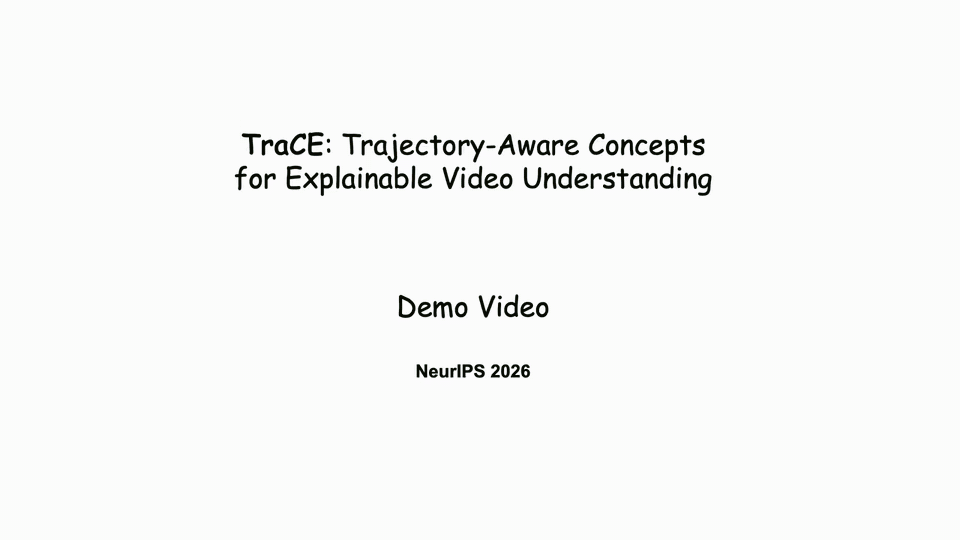

# TraCE: Trajectory-Aware Concepts for Explainable Video Understanding
### NeurIPS 2026

[](https://leewooil.github.io/TraCE_project_page/) [](https://leewooil.github.io/TraCE_project_page/) [](https://vll.khu.ac.kr/) [](LICENSE)

Wooil Lee<sup>1†</sup>, Junpyo Hong<sup>1†</sup>, Jongseo Lee<sup>1</sup>, Tuomas Oikarinen<sup>2</sup>, Tsui-Wei Weng<sup>2</sup>, Jinwoo Choi<sup>1*</sup>

<sup>1</sup>Kyung Hee University, <sup>2</sup>University of California San Diego &nbsp;·&nbsp; <sup>†</sup>Equal contribution, <sup>*</sup>Corresponding author

---
<p align="center">
  
</p>


## ✨ Highlights

- 🔍 Proposes **TraCE**, a concept-based framework that makes **which motion source** supports a video prediction explicit.
- 🌀 Turns clusters of **optical-flow trajectories** into concepts for people, objects and interactions, alongside **object** and **scene** concepts.
- 🎬 One typed concept interface explains both **action recognition** and **video question answering**.
- 🔄 Supports **exact per-concept contributions**, **concept interventions** and **concept removal** tests.

---

## 🛠️ Installation

```bash
conda create -n trace python=3.10 -y
conda activate trace

git clone https://github.com/KHU-VLL/TraCE.git && cd TraCE
pip install torch==2.5.1 torchvision==0.20.1 --index-url https://download.pytorch.org/whl/cu121
pip install -r requirements.txt
```

---

## 📁 Project Structure

```bash
TraCE/
│── src/            # discovery, features, ar, vqa, explain, third_party
│── tools/          # command-line entry points (discovery, extract, train, eval, explain)
│── scripts/        # one pipeline script per dataset
│── configs/        # per-dataset settings (ar/, vqa/, discovery/)
│── annotations/    # splits, class lists, QA files
│── concepts/       # object / scene vocabularies
│── notebooks/      # evaluation and intervention demos
│── requirements.txt
│── README.md
```

---

## 📂 Dataset

We used the following datasets in our experiments:

- [NTU RGB+D](https://rose1.ntu.edu.sg/dataset/actionRecognition/) (Mutual)
- [Something-Something V2](https://www.qualcomm.com/developer/software/something-something-v-2-dataset) (Chiral)
- [UCF101](https://www.crcv.ucf.edu/data/UCF101.php)
- [KTH Action](https://www.csc.kth.se/cvap/actions/)
- [TOMATO](https://github.com/yale-nlp/TOMATO)
- [STAR](https://github.com/csbobby/STAR)

Splits and QA files are in `annotations/<dataset>/`. Backbone weights (VideoMAE, InternVideo2) go in `pretrained/`.

---

## 🔎 Trajectory Concept Discovery

```bash
VIDEO_ROOT=data/ntu_mutual/videos bash scripts/ntu_mutual.sh trajectory   # trajectory concepts
VIDEO_ROOT=data/ntu_mutual/videos bash scripts/ntu_mutual.sh text         # object / scene concepts
```

---

## 🚀 Training

```bash
VIDEO_ROOT=data/ntu_mutual/videos bash scripts/ntu_mutual.sh ar    # action recognition
VIDEO_ROOT=data/ntu_mutual/videos bash scripts/ntu_mutual.sh vqa   # video question answering
```

---

## 📊 Evaluation & Visualization

```bash
python tools/eval_ar.py --bundle runs/ar/ntu_mutual --features work/ntu_mutual/features_ar/val_videomae.pt \
    --annotation annotations/ntu_mutual/val.csv --removal
python tools/explain_ar.py --bundle runs/ar/ntu_mutual --video clip.mp4 --overlay 3 --out_dir outputs/explain_ar
```

Evaluation and concept intervention demos are included in:

- `notebooks/demo_action_recognition.ipynb`
- `notebooks/demo_video_qa.ipynb`

<p align="center">
  
</p>


## 📎 Citation

```bibtex
@inproceedings{lee2026trace,
  title={TraCE: Trajectory-Aware Concepts for Explainable Video Understanding},
  author={Lee, Wooil and Hong, Junpyo and Lee, Jongseo and Oikarinen, Tuomas and Weng, Tsui-Wei and Choi, Jinwoo},
  booktitle={NeurIPS},
  year={2026}
}
```

---

## 📜 License

This project is licensed under the [Apache 2.0 License](LICENSE).

---

## 🙏 Acknowledgements

This work builds upon:
[KHU-VLL/DANCE](https://github.com/KHU-VLL/DANCE),
[Trustworthy-ML-Lab/Label-free-CBM](https://github.com/Trustworthy-ML-Lab/Label-free-CBM),
[Trustworthy-ML-Lab/Multi-Modal-CBM](https://github.com/Trustworthy-ML-Lab/Multi-Modal-CBM)
