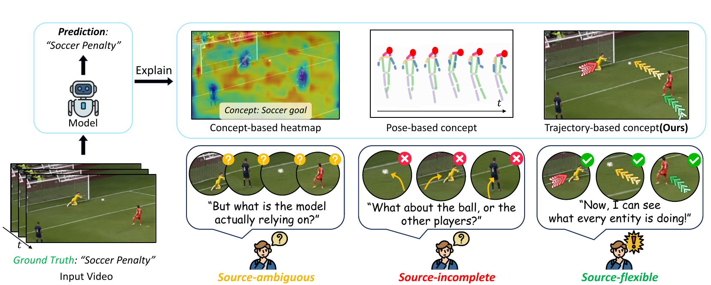

<div align="center">

<h1>🎯 TraCE: Trajectory-Aware Concepts<br>for Explainable Video Understanding</h1>

<p>
<b>Wooil Lee</b><sup>1†</sup> &nbsp;·&nbsp;
<b>Junpyo Hong</b><sup>1†</sup> &nbsp;·&nbsp;
<b>Jongseo Lee</b><sup>1</sup> &nbsp;·&nbsp;
<b>Tuomas Oikarinen</b><sup>2</sup> &nbsp;·&nbsp;
<b>Tsui-Wei Weng</b><sup>2</sup> &nbsp;·&nbsp;
<b>Jinwoo Choi</b><sup>1*</sup>
</p>

<p>
<sup>1</sup>Kyung Hee University &nbsp;&nbsp;&nbsp; <sup>2</sup>University of California San Diego
<br>
<sub><sup>†</sup>Equal contribution &nbsp;&nbsp; <sup>*</sup>Corresponding author</sub>
</p>

<h3>NeurIPS 2026</h3>

<!-- TODO: add the arXiv badge once available
<a href="https://arxiv.org/abs/XXXX.XXXXX"></a>
-->
<a href="https://leewooil.github.io/TraCE_project_page/"></a>

<a href="https://github.com/KHU-VLL/TraCE/stargazers"></a>


<br><br>



<p><i>Trajectory concepts make motion sources explicit: heatmaps are <b>source-ambiguous</b>, pose concepts are <b>source-incomplete</b>,<br>TraCE's trajectory concepts are <b>source-flexible</b>.</i></p>

</div>

<br>

> **TL;DR** — TraCE turns clusters of optical-flow trajectories into first-class explanatory concepts and pairs them with object and scene concepts. The same typed **trajectory / object / scene** interface explains both **action recognition** (sparse linear classifier) and **video question answering** (sparse concept matching), with exact per-concept contributions and concept-level interventions.

<table>
<tr>
<td align="center" width="25%">🌀<br><b>Trajectory concepts</b><br><sub>FINCH clusters of optical-flow trajectories from people, objects and interactions</sub></td>
<td align="center" width="25%">🧩<br><b>Typed interface</b><br><sub>trajectory for dynamic evidence, object &amp; scene for static context</sub></td>
<td align="center" width="25%">🎬<br><b>AR &amp; VQA</b><br><sub>one concept interface for class prediction and answer scoring</sub></td>
<td align="center" width="25%">🛠️<br><b>Explain &amp; intervene</b><br><sub>exact contributions, concept removal and Top-K / Random-K tests</sub></td>
</tr>
</table>

---

## 🛠️ Installation

Python 3.10 is recommended.

```bash
pip install torch==2.5.1 torchvision==0.20.1 --index-url https://download.pytorch.org/whl/cu121
pip install -r requirements.txt
```

Unit tests (no data needed): `python tests/test_core.py`

---

## 📁 Project Structure

```bash
TraCE/
│── src/                       # library
│   ├── ar/                    # action recognition head (model, training, data I/O)
│   ├── vqa/                   # VQA head (model, training, data I/O)
│   ├── explain/               # intervention / removal, trajectory overlays, plots
│   ├── features/              # VideoMAE and InternVideo2 feature extraction
│   ├── discovery/             # trajectory and object/scene concept discovery
│   └── third_party/           # vendored VideoMAE, InternVideo2, GLM-SAGA code
│── tools/                     # command-line entry points (extract, train, eval, explain)
│── scripts/                   # one pipeline script per dataset
│── configs/                   # per-dataset settings (ar/, vqa/, discovery/)
│── annotations/               # splits, class lists, QA files
│── concepts/                  # object / scene vocabularies (NTU RGB+D Mutual example)
│── notebooks/                 # evaluation, contribution and intervention demos
│── tests/                     # unit tests
│── requirements.txt
│── README.md
```

---

## 📂 Dataset

| Dataset | Task | Annotations |
|---|---|---|
| [NTU RGB+D](https://rose1.ntu.edu.sg/dataset/actionRecognition/) (Mutual, 5 classes) | AR, VQA | `annotations/ntu_mutual` |
| [Something-Something V2](https://www.qualcomm.com/developer/software/something-something-v-2-dataset) (Chiral SSv2, 32 classes) | AR, VQA | `annotations/chiral_ssv2` |
| [UCF-101](https://www.crcv.ucf.edu/data/UCF101.php) (split 1) | AR, VQA | `annotations/ucf101` |
| [KTH](https://www.csc.kth.se/cvap/actions/) | AR | `annotations/kth` |
| [TOMATO](https://github.com/yale-nlp/TOMATO) (direction) | VQA | `annotations/tomato` |
| [STAR](https://github.com/csbobby/STAR) | VQA | built with `tools/data/build_star_qa.py` |

Each annotation folder has `train.csv` / `val.csv` (`<video>,<label>`) and `class_list.txt`;
the AR datasets also have `qa_{train,val}.json` (5-choice QA built with `tools/data/build_qa_from_ar.py`).
TOMATO uses the direction subset with the OOD split (`direction_ood_{train,val}.json`).

Pass the video folder of each dataset as `--video_root` (or `VIDEO_ROOT` for `scripts/<dataset>.sh`);
video names in the annotation files are relative to it.
SSv2 ids and KTH videos are referenced as `.mp4` files.

---

## 🔎 Concept Discovery

**Trajectory concepts** (WAFT optical flow → trajectories → U²-Net foreground filtering → FINCH clustering → soft labels):

```bash
bash scripts/ntu_mutual.sh trajectory
```

**Object / scene concepts** (Qwen3-VL candidates → length / redundancy filtering):

```bash
bash scripts/ntu_mutual.sh text
```

The NTU RGB+D Mutual vocabularies are included in `concepts/ntu_mutual/` as an example; the `text` stage writes `concepts/<dataset>/` for the other datasets.
Per-dataset settings are in `configs/discovery/`. WAFT and U²-Net are used from their official repositories (`WAFT_ROOT`, `U2NET_ROOT`).

---

## 🚀 Training

Each `scripts/<dataset>.sh` runs the whole pipeline; pass a stage name to run one stage
(`trajectory`, `text`, `ar`, `vqa`). For example, action recognition on KTH:

```bash
python tools/extract_ar_features.py --annotation annotations/kth/train.csv --split train \
    --video_root data/kth/videos --sampling segment --videomae_ckpt checkpoints/backbones/videomae_kth.pth \
    --iv2_ckpt pretrained/InternVideo2-stage2_1b-224p-f4.pt --bert_path pretrained/bert-large-uncased \
    --out_dir work/kth/features_ar          # repeat with --split val

python tools/train_ar.py --config configs/ar/kth.yaml \
    --features_dir work/kth/features_ar \
    --trajectory_labels work/kth/trajectory_labels \
    --iv2_ckpt pretrained/InternVideo2-stage2_1b-224p-f4.pt --bert_path pretrained/bert-large-uncased \
    --out_dir runs/ar/kth
```

Video QA on NTU RGB+D Mutual:

```bash
python tools/extract_vqa_features.py --qa_json annotations/ntu_mutual/qa_train.json --format ar_qa \
    --video_root data/ntu_mutual/videos --iv2_ckpt ... --bert_path ... --out_dir work/ntu_mutual/features_vqa/train
                                        # repeat for qa_val.json -> .../val
python tools/train_vqa.py --config configs/vqa/ntu_mutual.yaml \
    --train_dir work/ntu_mutual/features_vqa/train --val_dir work/ntu_mutual/features_vqa/val \
    --trajectory_labels work/ntu_mutual/trajectory_labels \
    --iv2_ckpt ... --bert_path ... --out_dir runs/vqa/ntu_mutual
```


---

## 📊 Evaluation, Contribution & Intervention

```bash
# accuracy + Top-K / Random-K trajectory-concept removal
python tools/eval_ar.py  --bundle checkpoints/ar/kth --features work/kth/features_ar/val_videomae.pt \
    --annotation annotations/kth/val.csv --removal
python tools/eval_vqa.py --bundle checkpoints/vqa/ntu_mutual --split_dir work/ntu_mutual/features_vqa/val --removal

# explain one video: top trajectory / object / scene concepts, intervention, animated trajectory overlay
python tools/explain_ar.py --bundle checkpoints/ar/chiral_ssv2 --video clip.mp4 \
    --remove_top_trajectory 3 --overlay 3 --out_dir outputs/explain_ar
python tools/explain_vqa.py --bundle checkpoints/vqa/ucf101 --video v_PullUps_g01_c01.avi \
    --candidates PlayingTabla PullUps Diving MilitaryParade Rowing --remove_top_trajectory 3 --out_dir outputs/explain_vqa
```

- **AR contribution** of concept *m* to class *k*: `z_m * W[k, m]` on the standardized activation `z`; contributions plus the class bias equal the logit.
- **VQA contribution** of concept *m* to candidate *j*: its term in the top-5 matching sum of its group (times `exp(gamma_g)`); contributions sum exactly to the candidate score.
- **Intervention**: AR sets the standardized activation (0 = training-set mean); VQA sets the raw video-side activation, then ReLU, normalization and top-5 are recomputed.
- **Removal** (`--removal`): Top-K / Bottom-K / Random-K trajectory concepts by contribution to the predicted class; reports flip rate and accuracy.
- `--overlay N` writes `overlay.gif` / `overlay.mp4`: the top-N concepts with the medoid trajectory of each trajectory concept drawn on the video, starting at the concept's Grad-CAM peak (Grad-CAM only places the drawing).

### Notebooks

- `notebooks/demo_action_recognition.ipynb` — evaluation, contributions, intervention, removal curves, trajectory overlay on the video (Chiral SSv2)
- `notebooks/demo_video_qa.ipynb` — evaluation, concept matching, intervention, removal (UCF-101)

They need the checkpoints and cached validation features below. Set `TRACE_VIDEO_ROOT` to the SSv2 video folder for the trajectory overlay.

```bash
jupyter notebook notebooks/
```

---

## 📦 Checkpoints

Download links will be added here. Released files:

```bash
checkpoints/
  ar/{ntu_mutual,chiral_ssv2,ucf101,kth}/            # TraCE AR heads
  vqa/{ntu_mutual,chiral_ssv2,ucf101,tomato,star}/   # TraCE VQA heads
  trajectory_concepts/<dataset>/                     # trajectory medoids + source locations
  backbones/videomae_{ntu_mutual,kth}.pth            # our fine-tuned VideoMAE-B/16
features/                                            # cached features (no videos or backbones needed)
  ar/<dataset>/{train,val}_{videomae,internvideo2}.pt
  vqa/<dataset>/{train,val}/                         # video_features.pt, text_features.pt, sample_index.json
```

Evaluation, contributions, interventions, the notebooks and training only need `checkpoints/` and `features/`.
To run on raw videos, also download the official weights into `pretrained/`:

```bash
pretrained/
  videomae_ssv2_finetune.pth        # VideoMAE ViT-B/16 fine-tuned on Something-Something V2 (Chiral SSv2)
  videomae_ucf101_finetune.pth      # VideoMAE ViT-B/16 fine-tuned on UCF-101
  InternVideo2-stage2_1b-224p-f4.pt # InternVideo2 Stage-2 1B (VQA, object/scene pseudo-labels)
  bert-large-uncased/               # Hugging Face tokenizer / config for InternVideo2
```

---

## 📎 Citation

```bibtex
@inproceedings{lee2026trace,
  title={TraCE: Trajectory-Aware Concepts for Explainable Video Understanding},
  author={Lee, Wooil and Hong, Junpyo and Lee, Jongseo and Oikarinen, Tuomas and Weng, Tsui-Wei and Choi, Jinwoo},
  booktitle={NeurIPS},
  year={2026}
}
```

---

## 🙏 Acknowledgements

This work builds upon [DANCE](https://github.com/KHU-VLL/DANCE),
[Label-free CBM](https://github.com/Trustworthy-ML-Lab/Label-free-CBM),
[MM-CBM](https://github.com/Trustworthy-ML-Lab/Multi-Modal-CBM),
[VideoMAE](https://github.com/MCG-NJU/VideoMAE),
[InternVideo2](https://github.com/OpenGVLab/InternVideo),
[GLM-SAGA](https://github.com/MadryLab/glm_saga),
[WAFT](https://github.com/princeton-vl/WAFT),
[U²-Net](https://github.com/xuebinqin/U-2-Net),
[FINCH](https://github.com/ssarfraz/FINCH-Clustering) and
[Qwen3-VL](https://github.com/QwenLM/Qwen3-VL).
Vendored code keeps its notices in `src/third_party/`.
